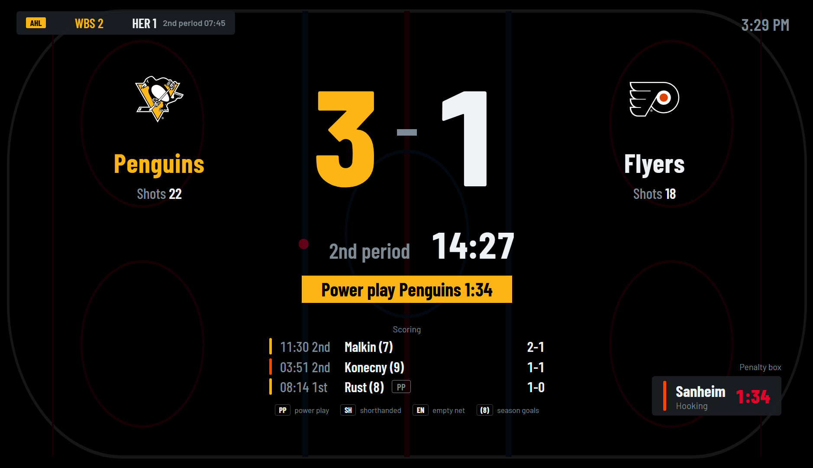
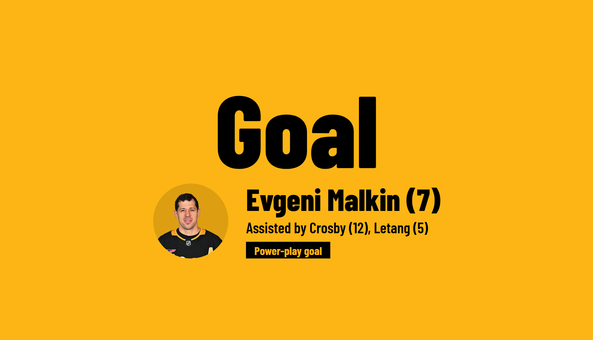
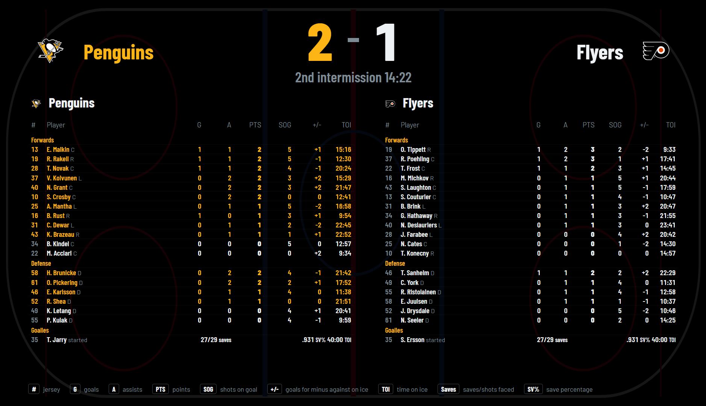
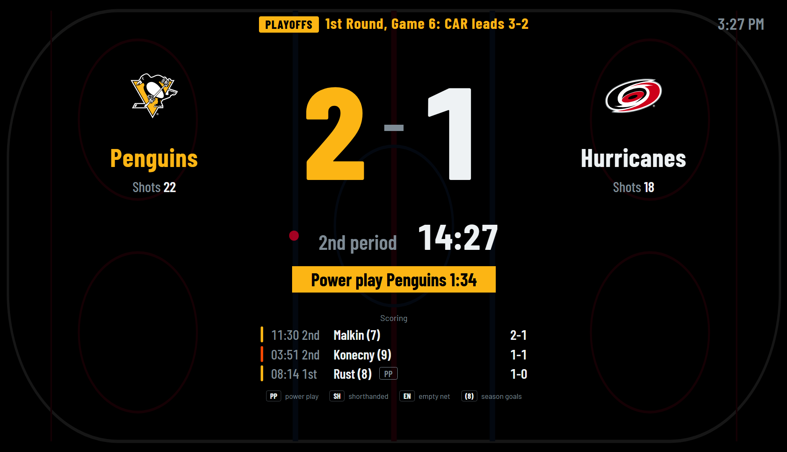
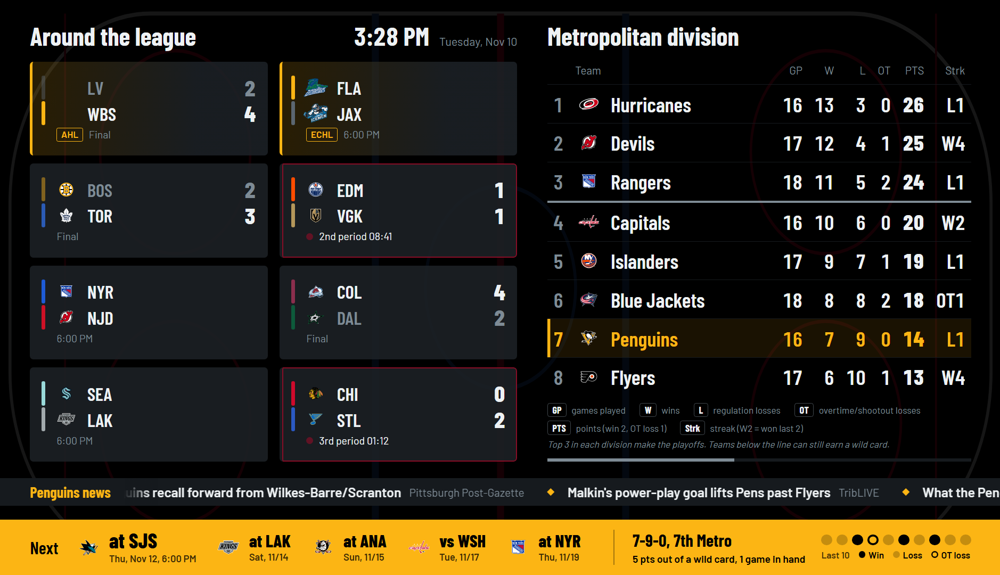
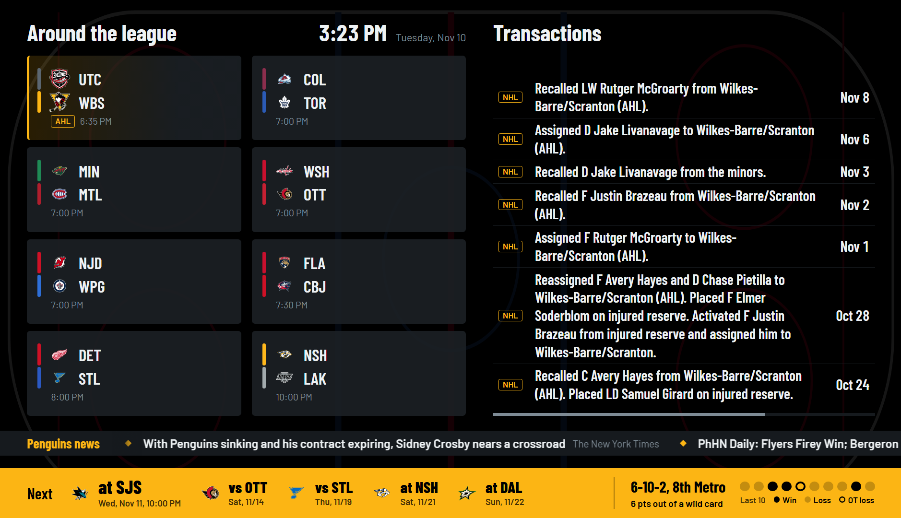
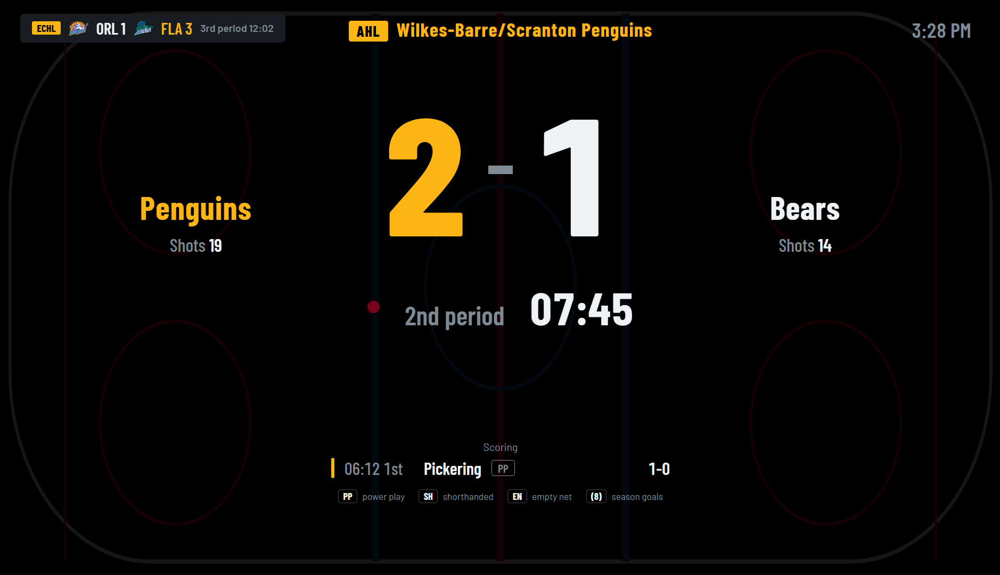

# Pens Wallboard

I wanted a scoreboard on my wall for Penguins games, so I built one. When the Pens are
playing it turns into a full scoreboard (and blows a goal horn when they score). The rest
of the time it cycles through NHL scores, standings, and whatever's going on with the team.
It also keeps tabs on the farm teams, the Wilkes-Barre/Scranton Penguins in the AHL and the
Florida Everblades in the ECHL.

Mine runs on an old Lenovo laptop with Linux Mint, plugged into a portable monitor. It should
work on a Raspberry Pi or pretty much any Linux box with a browser.

## Screenshots

| Live game | Goal |
|---|---|
|  |  |

| Lineups at intermission | Playoffs |
|---|---|
|  |  |

| Off days | Transactions |
|---|---|
|  |  |

| WBS game (with the Everblades score in the corner) |
|---|
|  |

## What it does

On game days it shows the matchup, puck drop, TV channel and goalies ahead of time. Once the game
starts you get the score, clock, shots, power plays, who's in the penalty box and the recent goals.
Goals get their own screen with the scorer and assists, and a horn if you want one. Intermissions
and the final show the line score, team stats, scoring summary or three stars, and the full lineups
with each player's numbers for the game.

On off days the left side has the day's scores and the right side rotates through the Metro, team
leaders, the wild card race, league leaders, prospects, transactions, injuries, milestones coming up,
and an "on this day" bit from Penguins history. The bottom bar has the next five games, the record
and how far out of a playoff spot they are, plus the last 10 games. There's a news ticker too.

It also switches into playoff mode (bracket and series scores) and offseason mode (countdowns to the
draft, free agency and opening night) on its own, and dims to a clock overnight.

When WBS or the Everblades are playing and the Pens aren't, their game takes over the screen. If the
Pens are on at the same time, the farm team score sits in the corner instead. Each team can have its
own goal horn.

All the stat screens have a small legend at the bottom, so you don't need to know what GAA or SV%
means to follow along.

## Trying it out

You'll need Python 3. Install the two dependencies:

    pip install -r requirements.txt

Then start it in one of the demo modes so you have something to look at without waiting for a game:

    DEMO=live python3 app.py

On Windows it's `set DEMO=live` and then `python app.py`. Open http://localhost:8080 and hit F11.

The demo modes are `live`, `intermission`, `final`, `gameday`, `off`, `playoffs`, `offseason`,
`affiliate` (WBS and the Everblades both on) and `echl` (just the Everblades). Leave `DEMO`
unset for real data. If you're testing at night, add `NIGHT=off` or you'll just get the clock.

## Running it on the wall

These steps are for Linux (Raspberry Pi OS or Mint). Change the username and paths to match yours.

    cd ~/pens-wallboard
    python3 -m venv venv
    venv/bin/pip install -r requirements.txt
    sudo cp pens-wallboard.service /etc/systemd/system/
    sudo systemctl enable --now pens-wallboard

That keeps the server running and starts it on boot. For the display, have the browser open
full screen when you log in. I use a little script that runs this:

    chromium --kiosk --autoplay-policy=no-user-gesture-required --password-store=basic \
      --noerrdialogs --disable-infobars --incognito http://localhost:8080

The autoplay flag is what lets the horn play without anyone clicking the page. The password-store
flag stops the keyring popup you get with auto-login on Mint.

You'll also want to turn off screen blanking and sleep, and set auto-login, so it comes back on its
own after a reboot. The page reloads itself whenever you update the files or restart the service.

## Goal horns

There's a basic built-in horn. To use your own, drop MP3s in `static/`:

- `horn.mp3` for the Penguins
- `horn-ahl.mp3` for WBS
- `horn-echl.mp3` for the Everblades

The farm team horns only go off when that team is the only one playing, so they don't step on a Pens
game. To test without waiting for a goal:

    curl -X POST http://<server-ip>:8080/api/test-goal
    curl -X POST "http://<server-ip>:8080/api/test-goal?team=WBS"

If you have goal lights or anything else you want to trigger, set `GOAL_HOOK_URL` (gets a POST with
the team) or `GOAL_HOOK_CMD` (runs a command).

## Settings

These go in the service file as `Environment=` lines (`sudo systemctl edit pens-wallboard`).

| Variable | Default | What it does |
|---|---|---|
| `TEAM` | `PIT` | Team to follow |
| `PREGAME_MINUTES` | `90` | How early the scoreboard takes over |
| `POSTGAME_MINUTES` | `30` | How long the final stays up |
| `GOAL_HOOK_URL` | none | URL that gets a POST when your team scores |
| `GOAL_HOOK_CMD` | none | Command to run when your team scores |
| `RECAP_UNTIL_HOUR` | `12` | Show last night's results until this hour |
| `NEWS` | `on` | `off` hides the news ticker |
| `NEWS_QUERY` | `Pittsburgh Penguins` | What the ticker searches for |
| `NEWS_MAX_HOURS` | `48` | Skip headlines older than this |
| `NIGHT` | `on` | `off` keeps the full board up overnight |
| `NIGHT_START` / `NIGHT_END` | `1` / `8` | Hours for the night clock |
| `GOAL_HORN` | `on` | `off` silences the horn |
| `HORN_VOLUME` | `0.6` | 0.0 to 1.0 |
| `HORN_MAX_SECONDS` | `0` | Fade a long horn out after this many seconds (0 plays it all) |
| `AFFILIATES` | `ahl:Wilkes-Barre,echl:Florida Everblades` | Farm teams to follow, as league:name |
| `AFFILIATE_TAKEOVER` | `on` | `off` keeps farm team games to the corner badge |
| `AFFILIATE_HORN` / `AFFILIATE_HORN_VOLUME` | `on` / same as `HORN_VOLUME` | Farm team horns |
| `AFFILIATE_HOOKS` | `off` | Also fire the goal hooks for farm team goals |
| `AFFILIATE_NEWS` | `on` | Mix farm team headlines into the ticker |
| `DRAFT_DATE` | last Friday of June | For the offseason countdown, e.g. `2027-06-25` |
| `FREE_AGENCY_DATE` | July 1 | For the offseason countdown |
| `PORT` | `8080` | Web port |

## Where the data comes from

None of this uses an official API, so things can break if a league changes something on their end.
I tried to make each piece fail quietly, so if one source goes down the rest of the board keeps going.

- NHL scores, standings, games, prospects and playoffs: the NHL's own site API (api-web.nhle.com).
  [This reference](https://github.com/Zmalski/NHL-API-Reference) is handy if something stops working.
- AHL and ECHL: HockeyTech, the stats provider behind both leagues' websites.
- Injuries and NHL transactions: ESPN. ECHL transactions come from echl.com. AHL transactions are hit or miss.
- News: Google News search results.

A few other things worth knowing:

- The NHL feed runs 10 to 30 seconds behind the TV, so the horn will go off a bit after you see the goal.
- The first time it starts, it downloads every past Penguins result for the "on this day" feature. That
  takes a few minutes and gets saved to `data/`. You can add your own moments in
  `data/history_events.json`, like `{"03-15": ["1995: Something happened"]}`.
- `affiliates.py`, `extras.py` and `demo.py` need to stay in the same folder as `app.py`.

## How I work on it

I test changes on my PC first and only push to `main` when they work, because the wall display
updates itself from `main`.

- `tools\run-local.bat` runs a copy on the PC (add a demo mode, like `run-local live`).
- `tools\save.bat "message"` commits and pushes to the `dev` branch. The wall ignores `dev`.
- `tools\release.bat "message"` runs `tools/check.py` and, if it passes, merges `dev` into `main`.

On the server, `deploy/update.sh` runs every 5 minutes from a systemd timer. If `main` has new
commits it pulls them and restarts the service, and if the new version doesn't start it rolls back.

## Disclaimer

This is just a fan project. It's not affiliated with the NHL, AHL, ECHL or any team. Team names and
logos belong to their owners. The logos load from the leagues' own servers and aren't included here,
and neither are any goal horn recordings, so you'll need to add your own.
